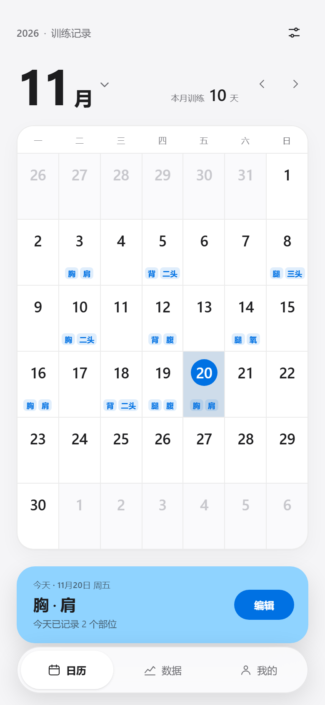
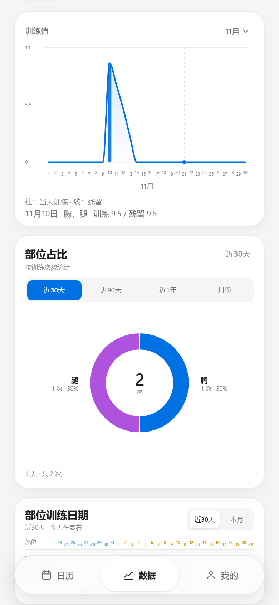
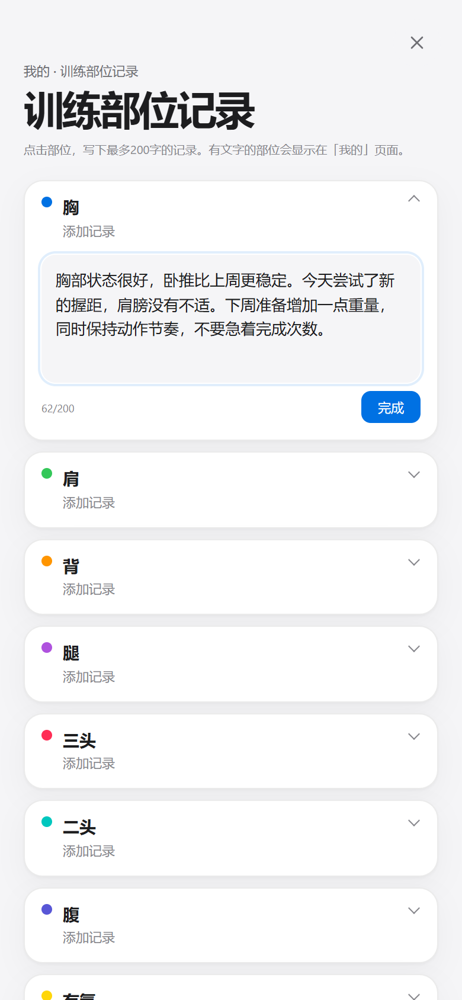
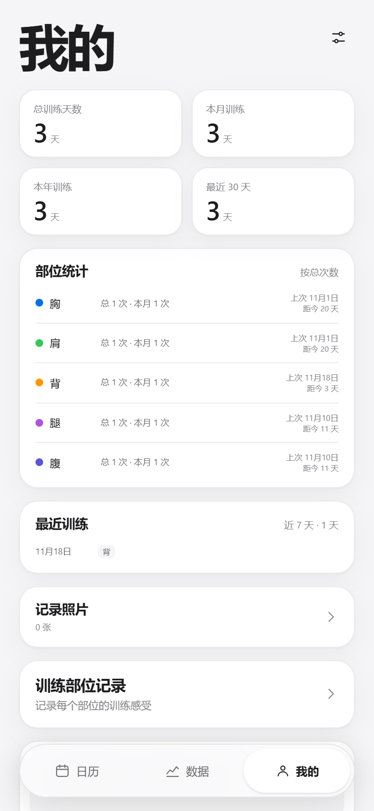

# 训练记录

一个只做一件事的 Android 训练日历：打开就是月历，点日期选中，双击日期直接编辑当天训练；训练部位直接显示在日期下方。

数据全部保存在本机，不需要账号、不联网、不上传。

## 下载

- [最新 APK](https://github.com/338871/lianji/releases/latest)
- 支持 Android 8.0 及以上
- 覆盖安装会保留原有记录、照片、训练笔记和设置

## 功能

- 月历 / 全年总览，灰色相邻月份日期也显示训练记录
- 双击日期打开训练编辑
- 训练部位自定义：改名、排序、删除、半档权重
- 每天训练笔记、最多 5 张照片、全屏照片查看
- 训练数据页：月 / 近30天 / 年曲线，部位占比，日期 × 部位训练表
- 数据页记住上次的时间模式，重启后仍保留
- 「我的」：训练统计、最近训练、记录照片、训练部位文字记录、训练笔记
- 备份导出 / 导入，全部数据仅保存在本机
- 随机诗句与「编辑模块显示」管理

## 截图

| 日历 | 数据 |
| --- | --- |
|  |  |

| 训练部位记录 | 我的 |
| --- | --- |
|  |  |

更多截图见 [screenshots](screenshots)。

## 技术

- 原生 HTML / CSS / JavaScript，无框架、无构建步骤
- PWA + IndexedDB 本地照片存储
- Android WebView 外壳，使用 `aapt2` / `javac` / `d8` / `apksigner` 构建
- 源码入口：`index.html`、`app.js`、`styles.css`
- Android 工程：`android/`

## 本地运行

```powershell
node serve.mjs
# 打开 http://127.0.0.1:4173
```

## 构建 APK

需要 Android SDK（platform 35、build-tools 35.0.0）和 JDK 17+。

```powershell
$env:ANDROID_SDK_ROOT = "C:\path\to\android-sdk"
$env:JAVA_HOME = "C:\path\to\jdk"
$env:LIANJI_KEYSTORE_PASS = "your-keystore-password"
powershell -ExecutionPolicy Bypass -File android/build-apk.example.ps1 -VersionName 2.6.0 -VersionCode 32
```

签名密钥 `android/keystore/` 不包含在仓库中。首次构建会在本机生成，请自行备份。

## 关于

- 应用名：训练记录
- 包名：`com.lianji.app`
- 当前版本：2.6.0
- GitHub：https://github.com/338871/lianji
