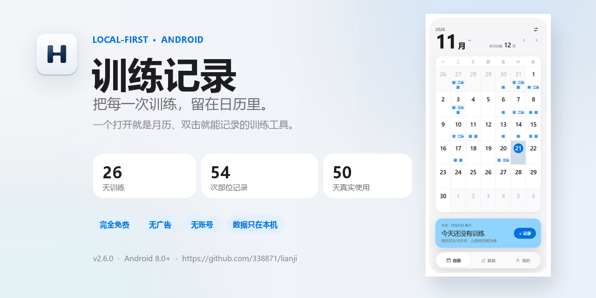
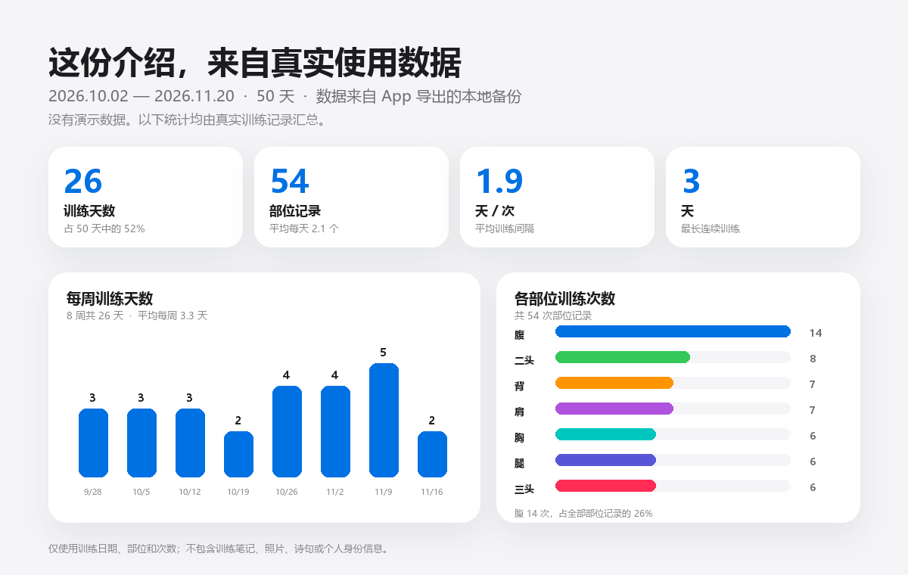
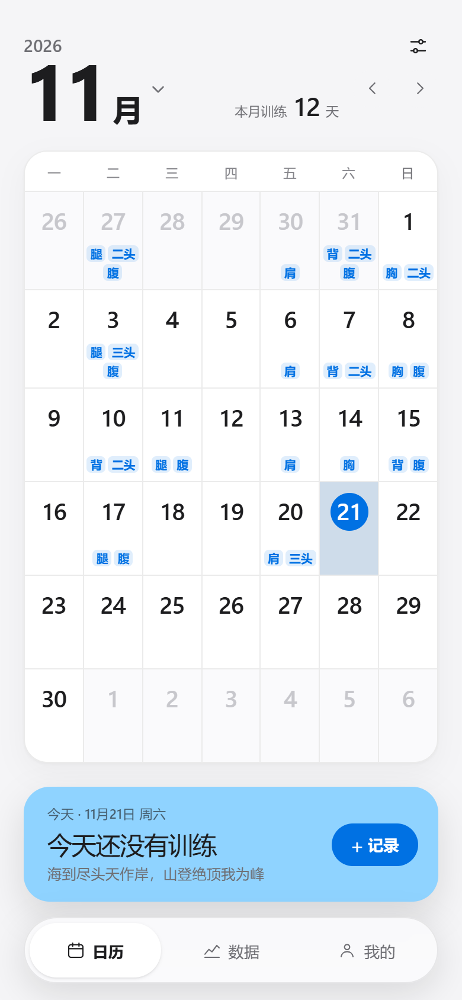
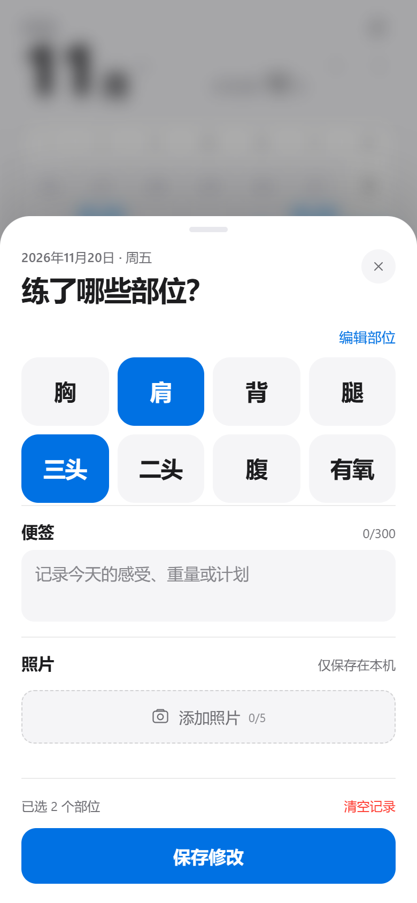
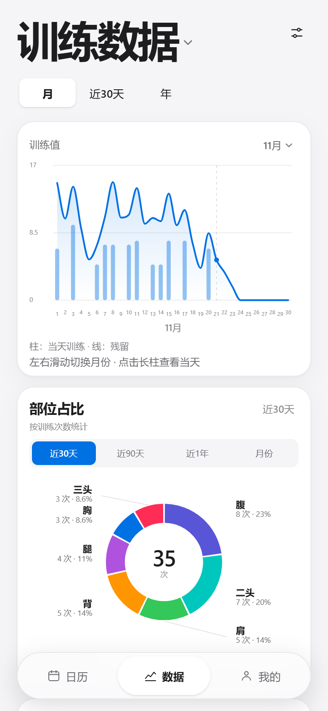
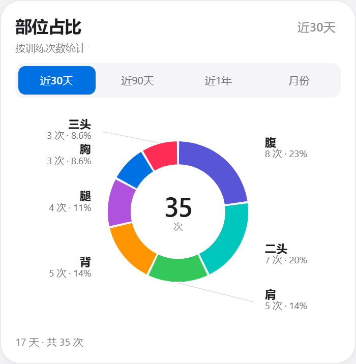
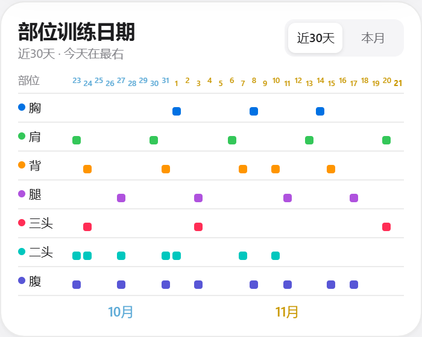
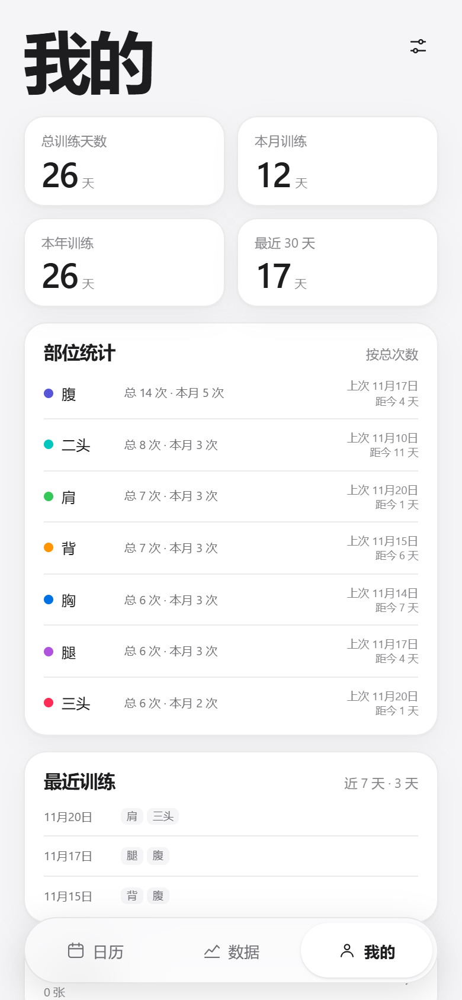
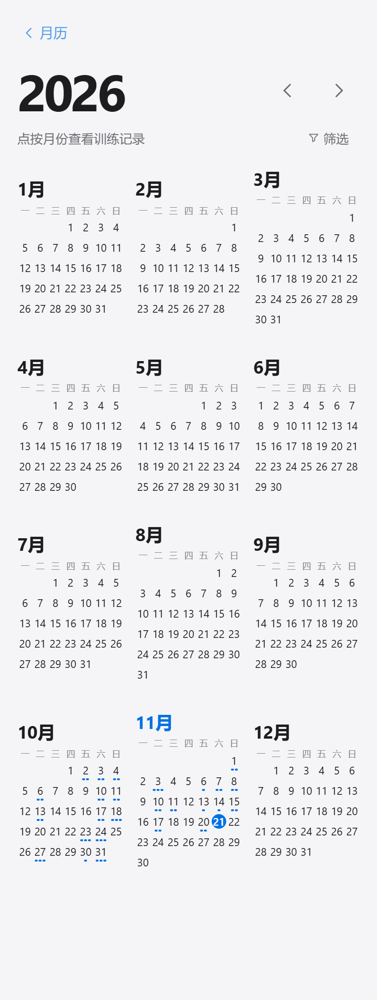

<div align="center">
  
</div>

<div align="center">

[](https://github.com/338871/lianji/releases/latest)
[](https://github.com/338871/lianji/releases/tag/v2.6.0)
[](#本地优先)
[](#隐私与数据)

<br>

[**下载 APK**](https://github.com/338871/lianji/releases/latest) · [**查看更新**](https://github.com/338871/lianji/releases) · [**问题反馈**](https://github.com/338871/lianji/issues)

</div>

---

> 这是一款完全免费、无广告、无内购的训练记录工具。  
> 创作的初衷，仅仅是为了每天的训练有迹可循。

**训练记录** 是一个只做一件事的 Android 训练日历：打开就是月历，点一下选中日期，双击直接记录当天练了什么。训练部位显示在日期下方，训练量、训练日期和长期节奏都能在数据页里看清楚。

没有账号，没有云端，没有信息流。所有训练、照片、笔记都只保存在你的手机里。

## 这不是演示数据

下面的统计来自一份真实的 App 本地备份：

- 记录时间：**2026.10.02 — 2026.11.20**
- 跨度：**50 天**
- 训练：**26 天**
- 部位记录：**54 次**

<div align="center">
  
</div>

| 真实使用指标 | 数据 |
| :--- | ---: |
| 训练天数 | **26 天**，占 50 天中的 52% |
| 部位记录 | **54 次**，平均每天 2.1 个 |
| 平均训练间隔 | **1.9 天 / 次** |
| 最长连续训练 | **3 天** |
| 单日最多部位 | **3 个** |
| 8 周平均频率 | **每周 3.3 天** |

### 这段时间练得最多的是

| 部位 | 次数 | 占全部部位记录 |
| :--- | ---: | ---: |
| 腹 | 14 | 25.9% |
| 二头 | 8 | 14.8% |
| 背 | 7 | 13.0% |
| 肩 | 7 | 13.0% |
| 胸 | 6 | 11.1% |
| 腿 | 6 | 11.1% |
| 三头 | 6 | 11.1% |
| 有氧 | 0 | 0% |

**26 天训练里，有 12 次是连续两天训练，最长连续 3 天。**  
这份数据没有经过挑选，它就是一个普通使用者真实的 50 天。

## 功能

### 一打开，就是日历

日期下面直接显示当天练过的部位。当前月份的日期是深色，相邻月份的日期是灰色，但**灰色日期同样会显示训练记录**。

例如看 11 月时，10 月 31 日练了胸和肩，10 月 31 日那一格就会显示「胸」「肩」。

双击任意日期，直接打开当天编辑界面；单击只选中日期，下方编辑模块同步更新。

<div align="center">
  
</div>

### 记录可以很轻，也可以很完整

- 自定义训练部位：改名、拖动排序、删除，删除后自动清理旧记录
- 每个部位独立权重，支持 0.5 档
- 每天最多 5 张训练照片，支持压缩 / 原图高清
- 全屏照片查看，按月、按日期整理
- 每天 300 字便签，红色圆点提示
- 训练笔记 1000 字，输入框缩短到约 90px 高

<div align="center">
  
</div>

### 数据页：看见训练留下的形状

- **月 / 近30天 / 年**三种曲线
- 柱子是当天训练量，平滑线是各部位残留
- 每个部位独立衰减，休息 4 天归零
- 点右上角月份可以切换月份，年份总览里可以切换年份
- 近30天和单月的日期颜色不同；近30天用淡蓝、黄、粉红区分月份
- 部位占比支持近30天 / 近90天 / 近1年 / 月份，点「月份」后再点上方月份才打开选择器
- 数据页会记住上次的时间模式，关掉应用再打开仍然保留

<div align="center">
  
</div>

<div align="center">
  
</div>

### 部位训练日期表

不是一句「最近练得不错」，而是把每个部位的训练日期直接排开：

- 行是训练部位，列是 30 天日期
- 有训练就画一个该部位颜色的圆角方块
- 没训练留空
- 日期上下错开，月份用同色大字号标出
- 不需要横向滑动，30 天一次展开

<div align="center">
  
</div>

### 我的：留下训练之外的东西

- 总训练天数、本月、本年、最近 30 天
- 部位统计、最近 7 天、记录照片
- 训练部位记录：按编辑顺序排列，每个部位最多 200 字；有文字的部位完整显示，没文字的不显示
- 训练笔记：1000 字，自动保存
- 备份导出 / 导入，所有数据只在本机

<div align="center">
  
</div>

### 一些小心思

- 日历空白时随机显示一句诗，默认内置 6 句
- 设置里的「编辑模块显示」可以修改、删除、新增、恢复默认
- 关于页有 GitHub 地址，点击用系统浏览器打开
- 训练部位权重下方注明「仅影响曲线图中训练值」

<div align="center">
  
</div>

## 本地优先

这是一款刻意不联网的训练工具：

- 不需要注册账号
- 不主动连接服务器、不请求远程接口
- 不上传训练数据
- 照片存在 IndexedDB，训练数据存在 localStorage
- 备份文件由你自己导出、自己保管
- 卸载应用会删除本机数据，请先导出备份

## 安装

1. 打开 [Releases](https://github.com/338871/lianji/releases/latest)
2. 下载最新的 `TrainingLog-x.x.x.apk`
3. 在 Android 手机上安装
4. 如果系统提示「未知来源」，允许当前文件管理器安装即可

支持 **Android 8.0 及以上**。新版本可以直接覆盖安装，原有记录、照片、训练笔记和设置会保留。

## 技术栈

| 层 | 实现 |
| :--- | :--- |
| 界面 | 原生 HTML / CSS / JavaScript，无框架、无构建步骤 |
| 存储 | localStorage + IndexedDB |
| 离线 | Service Worker + PWA manifest |
| Android | WebView 外壳，原生系统栏与文件保存桥接 |
| 构建 | `aapt2` / `javac` / `d8` / `zipalign` / `apksigner` |
| 图标 | Python + Pillow 生成自适应图标 |

## 项目结构

```text
lianji/
├─ index.html               App 页面结构
├─ styles.css               Apple 风格界面
├─ app.js                   日历、编辑器、数据与设置逻辑
├─ sw.js                    Service Worker
├─ manifest.webmanifest     PWA 配置
├─ icons/                   应用图标
├─ screenshots/             界面截图
├─ assets/                  GitHub 介绍图
├─ android/
│  ├─ AndroidManifest.xml
│  ├─ src/com/lianji/app/MainActivity.java
│  ├─ res/
│  └─ build-apk.example.ps1 构建脚本（不含签名密钥）
└─ tools/                   图标生成工具
```

## 本地运行

```powershell
node serve.mjs
```

打开 `http://127.0.0.1:4173`。

## 构建 APK

需要 Android SDK（platform 35、build-tools 35.0.0）和 JDK 17+。

```powershell
$env:ANDROID_SDK_ROOT = "C:\path\to\android-sdk"
$env:JAVA_HOME = "C:\path\to\jdk"
$env:LIANJI_KEYSTORE_PASS = "your-keystore-password"
powershell -ExecutionPolicy Bypass -File android/build-apk.example.ps1 -VersionName 2.6.0 -VersionCode 32
```

签名密钥 `android/keystore/` 不包含在仓库中。首次构建会在本机生成，请自行备份。

## 隐私与数据

本仓库中的统计只使用训练日期、部位和次数，**不包含**训练笔记、照片、诗句或任何个人身份信息。

App 本身没有服务器、没有账号系统，也不会主动上传任何内容。

## 链接

- **GitHub**：https://github.com/338871/lianji
- **Releases**：https://github.com/338871/lianji/releases
- **问题反馈**：https://github.com/338871/lianji/issues

---

<div align="center">

**训练记录 2.6.0**  
把每一次训练，留在日历里。

</div>
